## {.dtpf-title data-state="is-title" background-image="figures/brand/dtpf-banner.png" background-size="100% auto" background-position="top" background-repeat="no-repeat"}

::: {.ttl}
NUMERICAL MODELLING OF HEAT AND MASS TRANSFER\
WITH PHASE CHANGE\
USING A SHARP-INTERFACE TWO-FLUID METHOD
:::

::: {.authors}
[Louis Libat]{.speaker}, Vincent Le Chenadec, Can Selçuk, Eric Chénier
:::

::: {.affil}
Univ Gustave Eiffel, Univ Paris Est Créteil, CNRS, UMR 8208 MSME, F-77454 Marne-la-Vallée, France\
louis.libat2@univ-eiffel.fr
:::

::: {.venue}
Dispersed Two-Phase Flows, 6th edition — Société Hydrotechnique de France\
Chatou, 23–25 November 2026
:::

::: {.logos}
{fig-alt="MSME, CNRS and Université Gustave Eiffel logos"}
:::

## Bubbles and drops exchange heat and mass across a moving interface

::: {.cards}
::: {.card}
{fig-alt="Spillway of Bonneville Dam"}

::: {.lab}
Dissolution
:::
::: {.txt}
Air entrained at a spillway dissolves: dissolved-gas supersaturation downstream of dams
:::
:::

::: {.card}
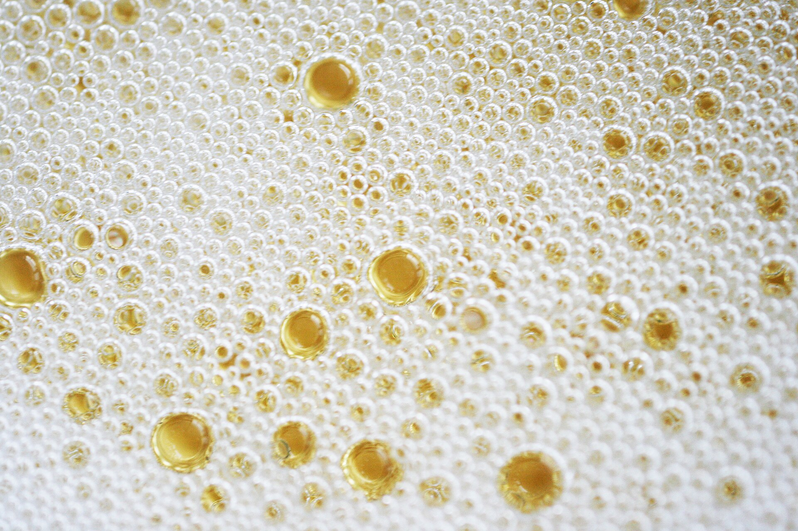{fig-alt="Bubbles in a glass of champagne"}

::: {.lab}
Degassing
:::
::: {.txt}
CO₂ bubbles grow as they rise through a supersaturated liquid
:::
:::

::: {.card}
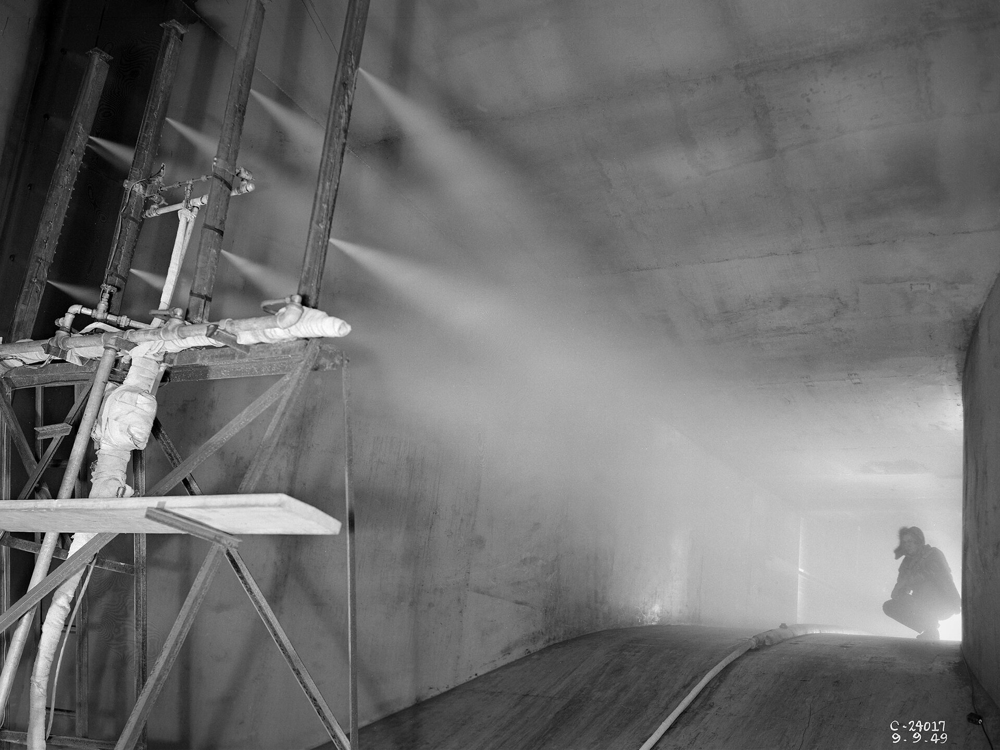{fig-alt="Water spray in the NASA Icing Research Tunnel"}

::: {.lab}
Sprays
:::
::: {.txt}
Drops evaporate in hot gas, or freeze on impact (icing)
:::
:::

::: {.card}
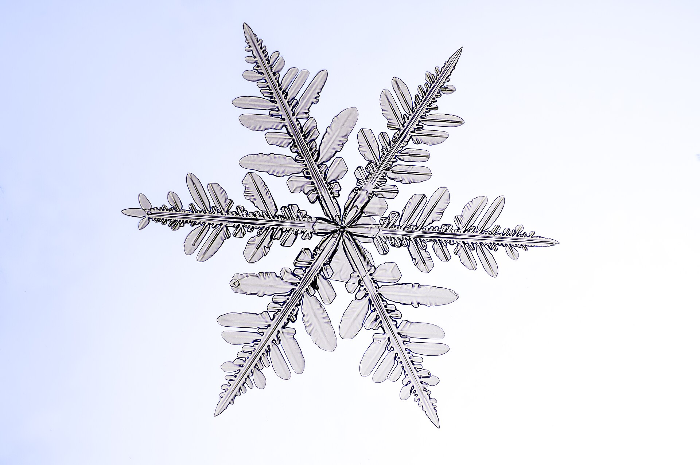{fig-alt="Stellar dendrite snowflake"}

::: {.lab}
Solidification
:::
::: {.txt}
Dendrites: latent heat and capillarity set the shape of the front
:::
:::
:::

::: {.credits}
Photos, Wikimedia Commons: Visitor7 (CC BY-SA 3.0); Q. Dombrowski (CC BY-SA 2.0); NASA Glenn Research Center (public domain); Janeklass (CC BY 4.0).
:::

## What makes these flows hard to compute

::: {.challenges .chbig}
::: {.chal}
::: {.head}
Fields jump across Γ
:::
::: {.eq}
$c_g = \He\, c_\ell$\
$\jump{\vect{u}} = \mdot\, \jump{1/\rho}\, \vect{n}$
:::
::: {.why}
Henry's law, the density jump: discontinuous unknowns
:::
:::

::: {.chal}
::: {.head}
Boundary layers are thin
:::
::: {.eq}
$\delta / d \sim \Pe^{-1/2} \approx 3\times 10^{-3}$
:::
::: {.why}
1 mm air bubble in water: the exchange rate is decided below the cell size
:::
:::

::: {.chal}
::: {.head}
Γ moves with the fluxes it controls
:::
::: {.eq}
$\mdot\, L + \jump{\vect{q}\cdot\vect{n}} = 0$
:::
::: {.why}
Stefan condition: the interface position is part of the solution
:::
:::
:::

::: {.goal .goalbig .fragment}
**Goal:** a **sharp**, conservative two-fluid method on a Cartesian grid, where the interface conditions
and the interface itself are unknowns.
:::

## Two-fluid: each phase keeps its own fields, across a sharp interface

::: {.tfdef}
[Two-fluid]{.tfbig} = two sets of fields, one per phase, each on **its own domain** $\Omega^\pm(t)$,
meeting only on a **sharp** interface $\Gamma(t)$ where they jump.
:::

::: {.tfrow}
::: {.tffig}
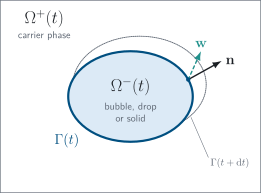{fig-alt="Domain split into a dispersed phase Omega minus and a carrier phase Omega plus by the moving interface Gamma, with normal n and interface velocity w"}
:::
::: {.tfnot .tfnotcol}
::: {.tfn}
[≠ one-fluid]{.tfnh} one set of fields for both phases, mixture properties, interface smeared over a few cells (VOF + CSF, level set, phase field)
:::
::: {.tfn}
[≠ averaged two-fluid]{.tfnh} interpenetrating phases, volume fractions $\alpha_k$ at every point, no interface position
:::
:::
:::

## Bulk equations: each phase obeys its own balance laws

::: {.twocol .bkeq}
::: {.colfig}
{fig-alt="Domain split into a dispersed phase Omega minus and a carrier phase Omega plus by the moving interface Gamma, with normal n and interface velocity w"}
:::

::: {.coleq}
::: {.bkin}
In each $\Omega^\pm(t)$:
:::

::: {.eqblock}
$$
\begin{aligned}
\nabla\cdot\vect u^\pm &= 0 && \lbl{mass}\\[2pt]
\rho^\pm\big(\partial_t\vect u^\pm + \vect u^\pm\!\cdot\nabla\vect u^\pm\big) &= \nabla\cdot\boldsymbol\sigma^\pm + \rho^\pm\vect g && \lbl{momentum}\\[2pt]
\rho^\pm c_p^\pm\big(\partial_t T^\pm + \vect u^\pm\!\cdot\nabla T^\pm\big) &= -\nabla\cdot\vect q^\pm && \lbl{energy}\\[2pt]
\rho^\pm\big(\partial_t Y^\pm + \vect u^\pm\!\cdot\nabla Y^\pm\big) &= -\nabla\cdot\vect j^\pm && \lbl{species}
\end{aligned}
$$
:::

::: {.defs}
$\boldsymbol\sigma^\pm = -p^\pm\mathbf I + 2\mu^\pm\mathbf D(\vect u^\pm), \qquad \vect q^\pm = -\lambda^\pm\nabla T^\pm, \qquad \vect j^\pm = -\rho^\pm D^\pm\nabla Y^\pm$
:::

::: {.keypoints}
- **Per phase:** unknowns $(\vect u^\pm, p^\pm, T^\pm, Y^\pm)$ — $d+3$ fields for $d+3$ equations.
- **No mixture:** $\rho^\pm,\ \mu^\pm,\ c_p^\pm,\ \lambda^\pm,\ D^\pm$ keep their own value on each side; coupling *only* through $\Gamma(t)$.
:::
:::
:::

## Across Γ: conservation gives balances, thermodynamics gives closures

::: {.defsline}
$\mdot = \rho^+(\vect u^+ - \vect w)\cdot\vect n = \rho^-(\vect u^- - \vect w)\cdot\vect n, \qquad V_\Gamma = \vect w\cdot\vect n, \qquad \kappa = \nabla_\Gamma\cdot\vect n$
:::

::: {.twobox}
::: {.box .bal}
::: {.boxhead}
Balances — fixed by conservation
:::
$$
\begin{aligned}
\mdot\,\jump{\vect u} - \jump{\boldsymbol\sigma}\,\vect n &= \nabla_\Gamma\gamma - \gamma\kappa\,\vect n && \lbl{momentum}\\[3pt]
\mdot\,L + \jump{\vect q\cdot\vect n} &= 0 && \lbl{energy}\\[3pt]
\mdot\,\jump{Y} + \jump{\vect j\cdot\vect n} &= 0 && \lbl{species}
\end{aligned}
$$

::: {.boxfoot}
$L = h^+ - h^-$ latent heat; kinetic energy and viscous work neglected.
:::
:::

::: {.box .clo}
::: {.boxhead}
Closures — a modelling choice
:::
$$
\begin{aligned}
\mathbf P_\Gamma\jump{\vect u} &= \vect 0 && \lbl{no slip}\\[3pt]
T^+ &= T^- = T_\Gamma && \lbl{thermal eq.}\\[3pt]
T_\Gamma &= T_{\mathrm{eq}}(Y^+, p) - \mathcal G\,\kappa - \beta\, V_\Gamma && \lbl{phase eq.}\\[3pt]
Y^- &= \Phi\big(Y^+, T_\Gamma, p\big) && \lbl{partition}
\end{aligned}
$$

::: {.cloname}
**Henry** (dissolution) · **Clausius–Clapeyron + Raoult** (evaporation) · **liquidus + partition coefficient** (alloys) · **Gibbs–Thomson** (curvature)
:::
:::
:::

::: {.consequence .fragment}
**Balances are fixed; closures change with the physics.**
:::

::: {.refs}
Delhaye (1974), *Int. J. Multiphase Flow* 1; Ishii & Hibiki (2011), *Thermo-Fluid Dynamics of Two-Phase Flow*.
:::


## Causality: as many equations as unknowns, in the bulk and on Γ

::: {.mgrid}
::: {.mhead}
:::
::: {.mhead}
unknowns
:::
::: {.mhead}
:::
::: {.mhead}
equations
:::

::: {.mlab .bulk}
Bulk\
[$\Omega^\pm(t)$]{.msub}
:::
::: {.mcell .bulk}
$\vect u^\pm,\ p^\pm,\ T^\pm,\ Y^\pm$ [$d+3$ per phase]{.k}

::: {.mtot}
total [$2(d+3)$]{.k}
:::
:::
::: {.marr .bulk}
$=$
:::
::: {.mcell .bulk}
mass, momentum, energy, species [$d+3$ per phase]{.k}

::: {.mtot}
total [$2(d+3)$]{.k}
:::
:::

::: {.mlab .intf .fragment fragment-index=1}
Interface\
[$\Gamma(t)$]{.msub}
:::
::: {.mcell .intf .fragment fragment-index=1}
$\vect u^+|_\Gamma,\ \vect u^-|_\Gamma$ [$2d$]{.k}\
$T^+|_\Gamma,\ T^-|_\Gamma$ [$2$]{.k}\
$Y^+|_\Gamma,\ Y^-|_\Gamma$ [$2$]{.k}\
mass flux $\mdot$ [$1$]{.k}\
normal speed $V_\Gamma$ [$1$]{.k}

::: {.mtot}
total [$2d+6$]{.k}
:::
:::
::: {.marr .intf .fragment fragment-index=1}
$=$
:::
::: {.mcell .intf .fragment fragment-index=1}
::: {.msplit}
::: {.mbal}
[balances]{.mgrp}\
mass, each side [$2$]{.k}\
momentum [$d$]{.k}\
energy [$1$]{.k}\
species [$1$]{.k}
:::
::: {.mclo}
[closures]{.mgrp}\
no slip [$d-1$]{.k}\
thermal eq. [$1$]{.k}\
phase eq. [$1$]{.k}\
partition [$1$]{.k}
:::
:::

::: {.mtot}
total [$2d+6$]{.k}
:::
:::
:::

::: {.punch .fragment fragment-index=2}
**The interface unknowns make the problem well posed:** they are the bulk problems' boundary data on $\Gamma$.
:::


## Cut cells: the interface conditions become rows of one linear system

::: {.ccgrid}
::: {.ccleft}
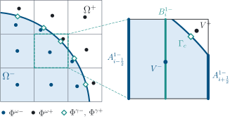{fig-alt="A 3 by 3 Cartesian patch cut by the bubble boundary, with bulk unknowns at the phase centroids and two interface unknowns at the interface centroid of each cut cell; a zoom on one cut cell shows its phase volumes, the wetted parts of its faces and the centroid plane B"}

::: {.ccmom}
One unknown per phase in each cell, two interface unknowns in each cut cell.
Only **volumes** and **surfaces** are needed.
:::
:::

::: {.ccright}
::: {.cchead}
In every cut cell $c$, two interface rows
:::
::: {.cceq .big}
$$
\begin{aligned}
\mathcal F^{+}_{\Gamma_c} + \mathcal F^{-}_{\Gamma_c} &= 0 && \lbl{flux balance}\\[4pt]
\Phi^{\gamma+}_c - \lambda\,\Phi^{\gamma-}_c &= F_c && \lbl{closure}
\end{aligned}
$$
:::
::: {.blocks .fragment}
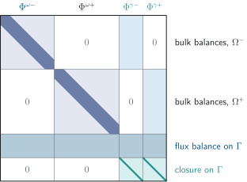{fig-alt="Block structure of the linear system: two banded bulk blocks for the two phases, coupled only through thin interface columns and the flux-balance and closure rows"}
:::
:::
:::

::: {.refs}
Libat et al., J. Comput. Phys. (2026, to be published).
:::


## Moving interface: time is one more coordinate

::: {.strow}
::: {.sttime}
One step of a cell = a **space‑time** box $[x_{i-\frac12}, x_{i+\frac12}]\times[t_n,\, t_n+\Delta t]$, cut by the surface swept by $\Gamma$.
Same cut-cell rules, one dimension up.
:::

::: {.stfig .big}
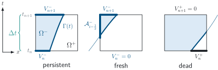{fig-alt="Three space-time cells in the x-t plane: a persistent cut cell, a fresh cell where phase minus appears during the step, and a dead cell where phase plus disappears"}
:::
:::

::: {.stcards}
::: {.stcard}
::: {.cchead}
Time-integrated volumes and surfaces
:::
$$\mathcal A^\pm = \int_{t_n}^{t_n+\Delta t}\!\! A^\pm(t)\,\d t$$
:::

::: {.stcard}
::: {.cchead}
Geometric conservation law
:::
$$V^\pm_{n+1} - V^\pm_n = \int_{t_n}^{t_{n+1}}\!\!\int_{\Gamma_c(t)} \vect w\cdot\vect n^\pm\,\d S\,\d t$$
:::

::: {.stcard}
::: {.cchead}
Fresh and dead cells
:::
$$V^\pm_n = 0 \quad\text{or}\quad V^\pm_{n+1} = 0$$

::: {.stwhy}
the same balance: no interpolation, no merging, exact conservation
:::
:::
:::

::: {.refs}
Libat et al., J. Comput. Phys. (2026, to be published).
:::


## Moving the interface: one residual, a Newton iteration

::: {.nwgrid}
::: {.nwleft}
::: {.rbox}
$$
r_c \;=\; \underbrace{V^-_{c,n+1} - V^-_{c,n}}_{\text{volume swept}} \;-\; \underbrace{\int_{t_n}^{t_{n+1}}\!\!\int_{\Gamma_c(t)}\Big(\vect u^-\cdot\vect n - \frac{\mdot}{\rho^-}\Big)\,\d S\,\d t}_{\text{volume the interface conditions demand}}
$$
:::
::: {.mdots}
::: {.md}
[heat (Stefan)]{.mdh}\
$\mdot = -\jump{\vect q\cdot\vect n}/L$
:::
::: {.md}
[species]{.mdh}\
$\mdot = -\jump{\vect j\cdot\vect n}/\jump{Y}$
:::
::: {.md}
[flow only]{.mdh}\
$\mdot = 0$: $\;V_\Gamma = \vect u\cdot\vect n$
:::
:::

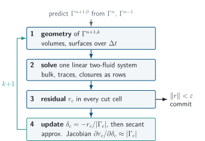{.nwloop .fragment fragment-index=1 fig-alt="Newton loop: predict, then compute the time-integrated volumes and surfaces, solve one linear two-fluid system, evaluate the residual in every cut cell, update the interface; repeat until the residual is below tolerance, then commit"}
:::

::: {.nwright .fragment fragment-index=2}
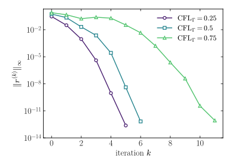{fig-alt="Residual norm against iteration on a log scale for the Frank disk at three interface CFL numbers: faster than linear, down to 1e-12 in 5 to 11 iterates"}

::: {.rcap}
Example: Frank disk, 32 cells, first step, Newton–Krylov update — faster than linear to round-off.
:::
:::
:::


## One loop, any interface representation

::: {.rpfig}
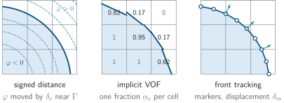{fig-alt="Three representations: one height per column for a wavy front, one volume fraction per cell with a PLIC segment, and a front of markers with normals"}
:::

::: {.rpgrid}
::: {.rptext}
A representation only provides:

1. the **volumes and surfaces** of a candidate interface;
2. a **move by a displacement** $\delta_c$ per cut cell.

Switching changes only these two; operators, interface rows and residual stay.
:::

::: {.rptab}
| representation | unknowns | vs one residual per cut cell |
|:--|:--|:--|
| signed distance | $\varphi$ moved by $\delta_c$ | square — any topology |
| implicit VOF¹ | one $\alpha_c$ per cut cell | square — any topology |
| front tracking² | one $\delta_m$ per marker | $M \neq C$: least squares + smoothing |
:::
:::

::: {.refs .refs2}
¹ Libat, Selçuk, Chénier, Le Chenadec, *A local volume conservation criterion and tearing algorithm for sharp interface flows with phase change: Part A — Application to VOF parametrization*, in preparation (Sept. 2026).\
² Libat, Selçuk, Chénier, Le Chenadec, *A local volume conservation criterion and tearing algorithm for sharp interface flows with phase change: Part B — Application to front-tracking parametrization*, in preparation (2026).
:::


## Henry transfer in 3-D: a bubble exchanging a dissolved gas

::: {.r10fig}
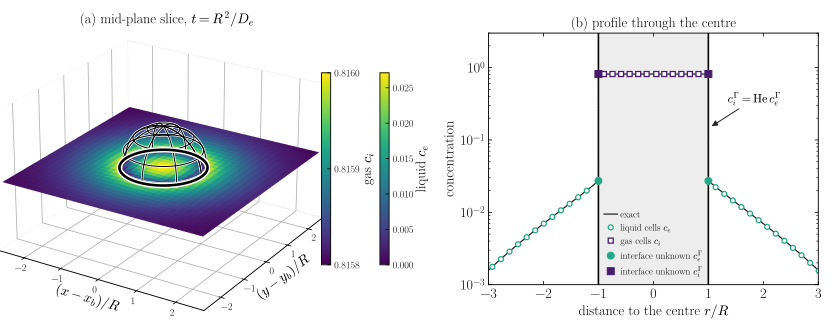{fig-alt="Left: concentration in the plane through the bubble centre, the gas uniform inside and a thin liquid layer outside, on the Cartesian grid. Right: profile through the centre on a log scale, computed against exact, with a jump of a factor thirty at the interface"}
:::

::: {.r10eq}
$$
\partial_t c_k = D_k\,\nabla^2 c_k \;\;\text{in } \Omega_k, \qquad
c_i = \He\, c_e, \quad D_i\,\partial_n c_i = D_e\,\partial_n c_e \;\;\text{on } \Gamma, \qquad
c_i(0) = 1,\; c_e(0) = 0
$$
:::

::: {.r10sub}
$i$: bubble or drop ($\Omega^-$), $e$: liquid ($\Omega^+$). Shown: a gas bubble in water, $\He = 30$, $D_i/D_e = 100$.\
Also run: a drop in a liquid ($\He = 0.5$, $D_i/D_e = 4$) and a liquid drop in a gas ($\He = 1/30$, $D_i/D_e = 0.01$).
:::


## Henry transfer in 3-D: a second-order Sherwood number

::: {.r10sub}
$\mathrm{Sh} = \bar q\, d \,/\, \big(D_e\, \bar c_i/\He\big)$, computed from the run histories, against the exact solution of Farsoiya et al. (2021).
:::

::: {.refs}
Farsoiya P. K., Popinet S., Deike L. (2021). Bubble-mediated transfer of dilute gas in turbulence. *J. Fluid Mech.* 920: A34.
:::

::: {.r10fig}
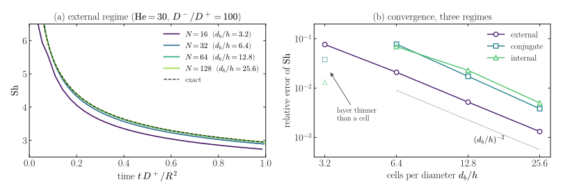{fig-alt="Left: Sherwood number against time in the external regime for four resolutions, converging to the exact curve. Right: relative error of the Sherwood number against cells per diameter for the external, conjugate and internal regimes, decreasing at second order"}
:::

::: {.r10cards}
::: {.r10card}
[Henry's law at round-off]{.r10h}\
$|c_i - \He\, c_e| \le 3\times10^{-16}$ — it is a row of the system
:::
::: {.r10card}
[Exact conservation]{.r10h}\
total amount drifts by $\le 10^{-8}$ in a closed box — the solver tolerance
:::
::: {.r10card}
[A bubble crossing the grid]{.r10h}\
amount within $0.1\,\%$ at 11 cells per diameter, oblique path — as accurate as the fixed one
:::
:::


## A rising bubble: Navier–Stokes, a moving interface and Henry transfer

::: {.r10sub}
Hysing et al. (2009) case 1 + a dissolved gas ($\He = 30$, $D_g/D_l = 100$):
Two-fluid space-time cut cells vs One-fluid CSF + tracer. 
:::

::: {.hygrid}
::: {.hyvid}
```{=html}
<video data-autoplay loop muted playsinline poster="figures/hysing3d_poster.png" src="figures/hysing3d.mp4"></video>
```
:::
::: {.hyfig}
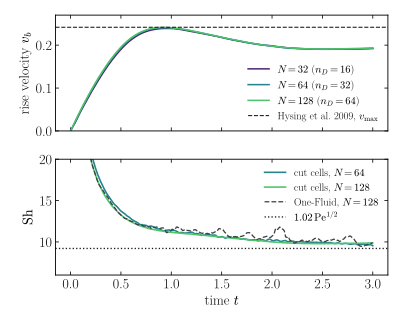{fig-alt="Top: rise velocity for three meshes reaching the maximum of Hysing et al., drawn as a dashed line. Bottom: Sherwood number, cut cells at two meshes converged, One-Fluid noisier and higher, with Boussinesq's potential-flow estimate as a dotted line"}
:::
:::

::: {.punch}
Rise on the benchmark ($v_{\max} = 0.2415$ vs $0.2417$). Sherwood number converged at 32 cells per diameter ($9.80 \to 9.82$),
where the one-fluid solver is still $3\,\%$ high and noisy.
:::

::: {.refs}
Hysing et al. (2009), *Int. J. Numer. Meth. Fluids* 60. One-Fluid: Basilisk `henry.h`, Farsoiya et al. (2021), *J. Fluid Mech.* 920.
:::

## Phase change with convection: melting and dissolution

::: {.g2}
::: {.g2col}
```{=html}
<video data-autoplay loop muted playsinline poster="figures/gal_tin.png" src="figures/gal_tin.mp4"></video>
```
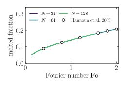{fig-alt="Melted fraction of tin against the Fourier number for three meshes, on the reference points of Hannoun et al. 2005"}

::: {.g2cap}
[Tin melted from a hot wall]{.galh} — Navier–Stokes + heat + Stefan on moving cut cells: melted fraction within $0.6\,\%$ of Hannoun et al. (2005) up to $\mathrm{Fo} = 2$.
:::

::: {.g2ref}
Hannoun N., Alexiades V., Mai T. Z. (2005). A reference solution for phase change with convection. *Int. J. Numer. Meth. Fluids* 48: 1283–1308.
:::
:::

::: {.g2col}
```{=html}
<video data-autoplay loop muted playsinline poster="figures/gal_disk.png" src="figures/gal_disk.mp4"></video>
```
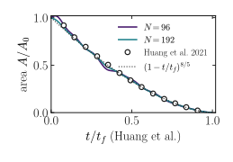{fig-alt="Area of the dissolving body against time on the time axis of Huang et al. (2021) for two meshes"}

::: {.g2cap}
[A body dissolving under its own plume]{.galh} — the history of Huang et al. (2021); close aggreement to the $8/5$-power law.
:::

::: {.g2ref}
Huang J. M., Shelley M. J., Stein D. B. (2021). A stable and accurate scheme for solving the Stefan problem coupled with natural convection using the immersed boundary smooth extension method. *J. Comput. Phys.* 432: 110162.
:::
:::
:::


## Take-home messages

::: {.thcols}
::: {.thcol}
::: {.thhead}
What to remember
:::

- **Interface conditions are rows** of one linear system, written for interface unknowns: new
  physics at $\Gamma$ is one new row.
- **Space-time cut cells**: discrete GCL, fresh and dead cells without interpolation, exact
  conservation.
- **One residual moves the interface** — volume swept against volume demanded, for heat, species or
  flow — driven to round-off, not split.
- **Any interface representation**: seen only through its volumes and surfaces — signed distance, VOF
  or front tracking, from 1-D to 3-D.
:::

::: {.thcol .thnextcol}
::: {.thhead}
Next
:::

- **Preconditioning** the coupled bulk–interface systems: robust to the smallest cut cells, built on
  the interface Schur complement.
- **Multicomponent transfer**: more than three species exchanged through the same interface rows —
  N₂, O₂, CO₂ … for the dissolution of entrained air.
:::
:::


## {.dtpf-title .dtpf-end data-state="is-title" background-image="figures/brand/dtpf-banner.png" background-size="100% auto" background-position="top" background-repeat="no-repeat"}

::: {.endthanks}
Thank you
:::

::: {.endswarm}
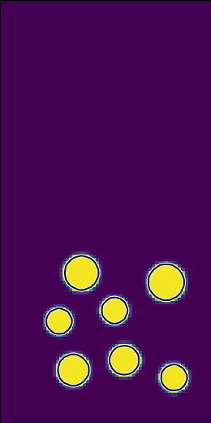{fig-alt="Animated bubble swarm: nine bubbles rising and exchanging a dissolved gas, which trails behind them as plumes"}

[Bubble swarm, dissolved gas]{.endswcap}
:::

::: {.endq}
Questions welcome
:::

::: {.endcontact}
**Louis Libat**\
[fastaxx.github.io](https://fastaxx.github.io)\
louis.libat2@univ-eiffel.fr
:::

::: {.endpaper}
- **A space-time Cartesian cut-cell method for two-phase diffusion problems using a two-fluid approach.** *J. Comput. Phys.* (2026), to be published — hal-05457114.
- **An analysis of symmetry and positive definiteness in a two-fluid cut-cell method.** Preprint (2026) — hal-05757396.
- **A two-fluid space-time cut-cell method for heat and mass transfer.** *ICCFD13*, Milan (2026) — hal-05732098.
- **A local volume conservation criterion and tearing algorithm for sharp interface flows with phase change: Part A — VOF parametrization; Part B — front-tracking parametrization.** In preparation (2026).

[With C. Selçuk, E. Chénier, V. Le Chenadec.]{.endwith}
:::

::: {.logos}
{fig-alt="MSME, CNRS and Université Gustave Eiffel logos"}
:::


## Appendix · Small cut cells: conditioning without cell merging {visibility="uncounted" data-state="is-appendix"}

::: {.apfig}
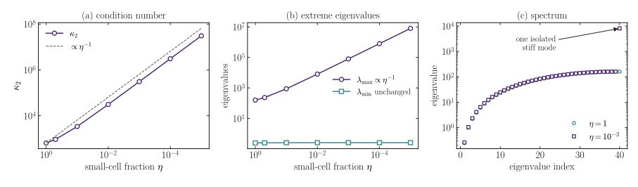{fig-alt="Three panels: condition number growing like one over eta; largest eigenvalue growing like one over eta while the smallest is unchanged; the spectrum with one isolated stiff mode"}
:::

::: {.apbul}
- $V^\pm$ appears in **no denominator**: only the staggered volumes $W^\pm$ of the gradient can inflate the operator.
- $\kappa_2 \propto \eta^{-1}$ because of **one stiff mode** localised on the small cell; $\lambda_{\min}$ and the rest of the spectrum are unchanged.
- A **diagonal or algebraic preconditioner** removes that mode.
:::


## Appendix · Computing the moments: Saye's quadrature {visibility="uncounted" data-state="is-appendix"}

::: {.bkgrid2}
::: {.bkfigs}
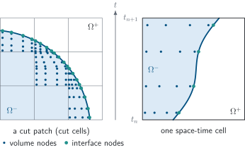{fig-alt="Quadrature nodes computed by CutQuadrature.jl: volume and interface nodes in the cut cells of a patch, and in one space-time cell crossed by a moving interface"}
:::

::: {.bktxt}
- Moments are integrals over the cut box: $V = \int_{\varphi<0} 1$, centroids, faces $A$,
  planes $B$, $|\Gamma| = \int_{\varphi=0} 1$.
- **Saye's dimension reduction**: Gauss nodes in one direction, roots of $\varphi$ on each line,
  Gauss nodes on each piece — order $2q$.
- **Space-time** is one more dimension: same rule in a $(d{+}1)$-D box.

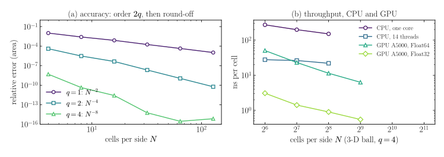{.cqconv fig-alt="Left: relative error of the quarter-disk area for q = 1, 2, 4, orders 2, 4, 8 then round-off. Right: nanoseconds per cell for a 3-D ball on one CPU core, 14 CPU threads, and an A5000 GPU in Float64 and Float32"}

::: {.bkcap}
CutQuadrature.jl. (a) quarter disk on an $N\times N$ grid. (b) 3-D ball: $128^3$ in 0.42 s on one core,
48 ms on an RTX A5000 (Float64), 3 ms in Float32.
:::
:::
:::


## Appendix · Cost: where the time goes {visibility="uncounted" data-state="is-appendix"}

::: {.apfig}
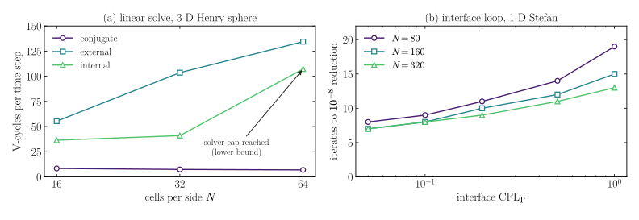{fig-alt="Left: multigrid V-cycles per time step against N for the three Henry regimes: about 7 for conjugate, growing to 107-134 for internal and external. Right: interface iterates per step against the time step for five meshes: the points collapse on one curve"}
:::

::: {.apbul}
- **Linear solve**: mesh-independent in the conjugate regime, but large Henry or diffusivity ratios cost 100+ V-cycles per step → **preconditioning**.
- **Interface loop**: iterates grow with the interface CFL — 7–8 at $\mathrm{CFL}_\Gamma = 0.05$, 13–19 at 1 — and barely with the mesh.
:::


## References {visibility="uncounted" data-state="is-appendix"}

::: {.refsl}
- **Libat L., Selçuk C., Chénier E., Le Chenadec V.** (2026). A space-time Cartesian cut-cell method for
  two-phase diffusion problems using a two-fluid approach. *J. Comput. Phys.*, to be published — hal-05457114.
- Libat L., Selçuk C., Chénier E., Le Chenadec V. (2026). A two-fluid space-time cut-cell method for heat
  and mass transfer. *ICCFD13*, Milan — hal-05732098.
- Libat L., Selçuk C., Chénier E., Le Chenadec V. (2026). A local volume conservation criterion and tearing algorithm for sharp
  interface flows with phase change: Part A — Application to VOF parametrization. In preparation.
- Libat L., Selçuk C., Chénier E., Le Chenadec V. (2026). A local volume conservation criterion and tearing algorithm for sharp
  interface flows with phase change: Part B — Application to front-tracking parametrization. In preparation.
- Quirós Rodríguez A., Fullana T., Sayadi T., Le Chenadec V. (2024). A levelset-based cut-cell method for
  interfacial flows, part 1. *Acta Mechanica* 236: 5763–5786.

- Delhaye J.-M. (1974). Jump conditions and entropy sources in two-phase systems. *Int. J. Multiphase Flow* 1: 395–409.
- Ishii M., Hibiki T. (2011). *Thermo-Fluid Dynamics of Two-Phase Flow*. Springer.
- Johansen H., Colella P. (1998). A Cartesian grid embedded boundary method for Poisson's equation on irregular domains. *J. Comput. Phys.* 147: 60–85.
- Farhat C., Geuzaine P., Grandmont C. (2001). The discrete geometric conservation law and the nonlinear stability of ALE schemes. *J. Comput. Phys.* 174: 669–694.
- Huang J. M., Shelley M. J., Stein D. B. (2021). A stable and accurate scheme for solving the Stefan problem coupled with natural convection using the immersed boundary smooth extension method. *J. Comput. Phys.* 432: 110162.
- Hysing S., Turek S., Kuzmin D., Parolini N., Burman E., Ganesan S., Tobiska L. (2009). Quantitative benchmark computations of two-dimensional bubble dynamics. *Int. J. Numer. Meth. Fluids* 60: 1259–1288.
- Hannoun N., Alexiades V., Mai T. Z. (2005). A reference solution for phase change with convection. *Int. J. Numer. Meth. Fluids* 48: 1283–1308.
- Hester E. W., Couston L.-A., Favier B., Burns K. J., Vasil G. M. (2020). Improved phase-field models of melting and dissolution in multi-component flows. *Proc. R. Soc. A* 476: 20200508.
- Popinet S. (2009). An accurate adaptive solver for surface-tension-driven interfacial flows. *J. Comput. Phys.* 228: 5838–5866.
- Popinet S. (2015). A quadtree-adaptive multigrid solver for the Serre–Green–Naghdi equations. *J. Comput. Phys.* 302: 336–358.
- Farsoiya P. K., Popinet S., Deike L. (2021). Bubble-mediated transfer of dilute gas in turbulence. *J. Fluid Mech.* 920: A34.
- Saye R. I. (2015). High-order quadrature methods for implicitly defined surfaces and volumes in hyperrectangles. *SIAM J. Sci. Comput.* 37: A993–A1019.
- Chierici A. et al. (2022). An optimized Vofi library to initialize the volume fraction field. *Comput. Phys. Commun.* 281: 108506.
- Tryggvason G. et al. (2001). A front-tracking method for the computations of multiphase flow. *J. Comput. Phys.* 169: 708–759.
:::

